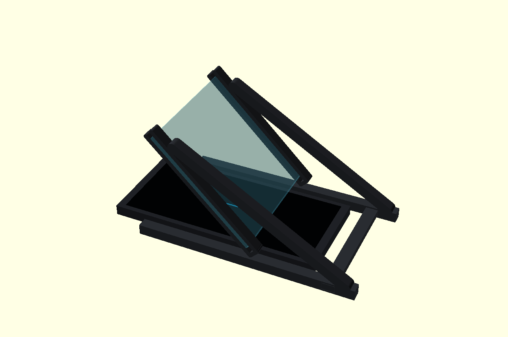

# Desktop Pepper’s Ghost MVP (OPPO Reno3 Vitality)

[简体中文](#中文说明) · [English](#english-summary)



> **Status: prototype / not yet physically verified.** This is a 45° acrylic reflection display (**Pepper's Ghost**), not true volumetric or free-space holography. The image is a CAD preview, not a photograph of a working optical system.

## 中文说明

一个低成本、可修改、可 3D 打印的桌面人物反射成像实验，用 **OPPO Reno3 元气版**作为视频源，用现有 **100×100 mm**（或扩展 **150×150 mm**）亚克力板作为反射片。

这个仓库是 V0.2 工程原型：先验证手机、亚克力、观众视线与素材方向，不承诺实际亮度、无重影或长时间可靠运行。

### 设计参数

| 项目 | V0.2 |
| --- | --- |
| 视频源 | OPPO Reno3 元气版（Reno3 Vitality），约 160.3 × 74.3 × 7.96 mm（裸机） |
| 显示屏 | 6.4 英寸 AMOLED，2400 × 1080，20:9 |
| 反射片 | 100 × 100 mm 或 150 × 150 mm 亚克力 |
| 反射片厚度 | 2 或 3 mm（务必实际测量） |
| 反射片角度 | 相对桌面 45° |
| 反射片下沿基准高度 | 18 mm（V0.1 为 10 mm） |
| 100 mm 版内侧净宽 | 约 84 mm，裸机宽约 74.3 mm，两侧总余量约 9.7 mm |
| 手机固定方式 | **无手机夹持**；手机屏幕朝上、平放在支架之间 |

**不要把估算当成保证。** 3 mm 板在标称位置时，反射板最低表面至裸机顶部的几何间隙估算约 9 mm；镜头凸起、壳体、打印公差、板材实际尺寸、桌面倾斜均可改变结果。安装前必须实体核验。

### 项目结构

```text
hardware/
  holodesk_reno3_v02.scad       # 可编辑 OpenSCAD 参数化源代码
  stl/
    bracket_100mm_2mm.stl      # 支架：每套打印 2 件
    bracket_100mm_3mm.stl
    bracket_150mm_2mm.stl
    bracket_150mm_3mm.stl
    bridge_100mm.stl           # 定位横杆：每套 1 件
    bridge_150mm.stl
software/
  test_player_reno3.html       # 安卓离线测试播放器，无网络依赖
assets/
  preview_reno3_100mm.png      # CAD 装配预览
scripts/
  validate_meshes.py          # STL 封闭性验证
  build_stl.sh                # 从 SCAD 重新导出 STL
.github/workflows/
  validate.yml                # GitHub CI 检查
 docs/README_使用说明.md        # 详细安装、光学与验收说明
LICENSE                        # MIT
CHANGELOG.md
CONTRIBUTING.md
```

### 3D 打印与装配

1. **测量亚克力**：确认边长与厚度；选匹配的 `bracket_<边长>mm_<厚度>mm.stl`，**打印两件**，另打印一件 `bridge_<边长>mm.stl`。
2. **先组支架后放手机**：去掉毛刺，检查反射板插槽是否合适，不要强塞以免裂开；先不放手机检查整体稳固。
3. **摆放手机**：Reno3 裸机屏幕朝上，长边沿支架前后（深度）方向，居中置于两侧支架之间；手机底部直接接触桌面，**没有卡槽固定**。
4. **间隙检查**：实测反射板最低处与手机屏幕间隙（包括壳和镜头凸起影响）；确保不会接触或压迫屏幕，并给 USB-C 供电线预留空间。
5. **打开播放器**：使用安卓浏览器打开 `software/test_player_reno3.html`，选择校准十字，依据实际反射结果调节旋转、镜像、比例、位置，之后切换人物轮廓。
6. **光学测试**：室内光线、暗场、增加遮光卡纸，分别拍摄对比亮度和双面重影。不要仅凭 CAD 图判断投影成效。

**注意**：普通透明亚克力的两面均可能产生反射，造成双像或鬼影；要提高质量，后续可研究单面半透半反膜及黑色遮光罩。当前原型未包含电源管理、长时间运行安全或实体外壳。

### 开发与验证

使用 [OpenSCAD](https://openscad.org/) 编辑 `hardware/holodesk_reno3_v02.scad`。文件开头可设置 `panel_size`、`panel_thickness`、`slot_clearance`、`view_angle`、`plate_bottom_z` 等参数。

```bash
bash scripts/build_stl.sh
python -m pip install trimesh
python scripts/validate_meshes.py
```

工作流检查 6 个 STL 的封闭性并验证 HTML 内嵌脚本语法。**网格封闭 ≠ 实体打印验证 ≠ 通过光学验收。**

### 版本与路线

- **V0.1**：通用手机单片反射方案。
- **V0.2**：匹配 Reno3 元气版尺寸，板材下沿抬高到 18 mm；播放器增加角度、左右镜像、缩放、位移；已提供完整可修改源码与 STL。
- **下一步（尚未实现）**：带壳间隙实测、可调手机定位、遮光外壳、材料反射率实验与真实人物影像测试。

## English summary

A low-cost desktop **Pepper's Ghost** experiment using an OPPO Reno3 Vitality AMOLED phone, a single 100×100 mm (or 150×150 mm) acrylic plate at 45°, and printable support brackets. Includes parametric OpenSCAD CAD, six STL files, a standalone offline HTML alignment player, and build checks.

**No real-world prototype has been confirmed working.** The design does not create free-floating 3D holograms and does not include an enclosure or a phone clamp. Measure the plate thickness and clearance before using it above a phone.

## License

MIT License, copyright © 2026 NewBie7666. See [LICENSE](LICENSE).

The optical technique is a known principle; this repository licenses the project's original CAD, scripts and documentation, **not** third-party patents, marks or inventions. Any contributions must be appropriately licensed.